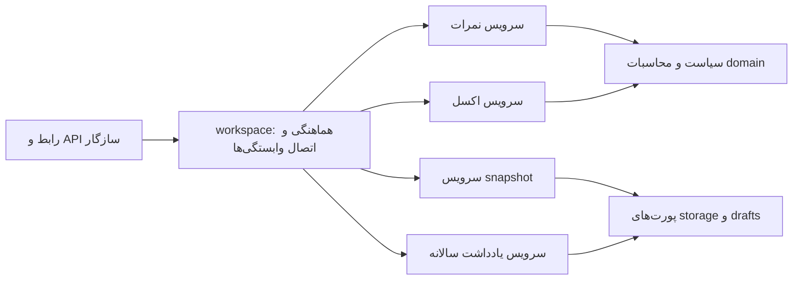

# بازآرایی معماری مشترک و CSS — ۲۰۲۶/۱۱/۱۸

مبنای تغییر، نسخهٔ `0aa4c95` است. منطق محاسبه و تهیهٔ داده از scope مشترک workspace به چهار سرویس با وابستگی صریح منتقل شد. هشت stylesheet چندموضوعی نیز به فایل‌های موضوعی تقسیم شدند؛ هر دو CSS خروجی بایت‌به‌بایت با نسخهٔ قبل برابرند.

## معماری و مالکیت وضعیت

| سرویس مستقل                                                 | مسئولیت                                                            | خطوط قبلی در scope مشترک | خطوط adapter فعلی |
| ----------------------------------------------------------- | ------------------------------------------------------------------ | -----------------------: | ----------------: |
| [نمرات و گزارش سالانه](../src/services/grading-results.js)  | محاسبهٔ نمره، سازگاری درس بین ترم‌ها، projection پودمان و واحد کار |                      ۴۰۶ |                ۶۲ |
| [اکسل کارنامه](../src/services/karnameh-excel.js)           | ساخت دادهٔ sheet از snapshot و انتخاب هنرجو/درس                    |                      ۳۷۵ |                ۱۷ |
| [پشتیبان نصب](../src/services/installation-backup.js)       | snapshot، پیش‌نویس قابل‌انتقال و امضای منبع                        |                      ۳۲۰ |                ۶۸ |
| [دامنهٔ یادداشت سالانه](../src/services/year-note-scope.js) | cache دامنه و مجوز خصوصی هر نمونه                                  |                       ۸۷ |                ۳۰ |
| مجموع                                                       |                                                                    |                     ۱۱۸۸ |               ۱۷۷ |

این اعداد اندازهٔ scope مشترک همان چهار فایل را نشان می‌دهند؛ کاهش تعداد خطوط کل پروژه یا درصد بهینگی نیستند. بدنهٔ سرویس‌ها، اتصال وابستگی‌ها و تست‌های جدید نیز بخشی از کد پروژه‌اند.

workspace مالک انتخاب صفحه، اتصال فعال، صف ذخیره، پیام رابط و قراردادهای سازگار قبلی است. سرویس‌ها از پارامتر factory، callback زنده یا snapshot صریح استفاده می‌کنند. هر نمونهٔ سرویس، cache و مجوز خود را دارد؛ چیزی از نمونهٔ دیگر به ارث نمی‌برد. تهیهٔ sheets همگام مانده و دانلود فایل و پیام موفقیت در adapter میزبان انجام می‌شوند.

پیش از تغییر، منطق این چهار بخش به‌ترتیب ۹، ۱۰، ۲۹ و ۱۰ نام آزاد برنامه یا پلتفرم را از محیط می‌خواند. در سرویس‌های جدید چنین binding آزادی وجود ندارد؛ وابستگی‌ها همچنان وجود دارند و اکنون در قرارداد factory مشخص‌اند. امکانات استاندارد زبان و انتشار نام factory در این شمارش نیستند.

`application-services.js` پیش از `workspace-runtime.js` بارگذاری می‌شود. قالب classic آفلاین و APIهای فعلی حفظ شده‌اند. workspace همچنان scope خصوصی هماهنگی رابط را نگه می‌دارد؛ state خصوصی سرویس‌ها داخل همان factoryها قرار دارد. schema، کلیدها و نام فایل‌های داده تغییر نکردند.

## کنترل دائمی مرزها

[کنترل معماری](../scripts/architecture-boundaries.cjs) به lint متصل است و در تست‌ها نیز اجرا می‌شود. این کنترل موارد زیر را رد می‌کند:

- خواندن متغیر آزاد برنامه یا API تزریق‌نشدهٔ DOM، storage و timer از داخل سرویس؛
- نگهداری state بیرون factory، حتی در IIFE خصوصی که بین نمونه‌ها مشترک می‌شود؛
- انتشار نام اضافه، فرار alias ریشهٔ global، و تعریف تابع پویا؛
- ثبت تکراری یا نادرست منبع و بارگذاری سرویس پس از workspace.

این کنترل، قرارداد نگهداری کد است و sandbox امنیتیِ اجرای کد نیست. تست‌های مستقل، جدابودن دو نمونه، تعویض داده و writer حین انتظار، رد نتیجهٔ منقضی و عدم اختلاط هنرجویان را بررسی می‌کنند. تست نمرات با getterهای ممنوع برای `db`، `workspace`، `document` و storage نیز اجرا می‌شود.

بازبینی مستقل بدنهٔ نمرات، برابری AST هر نه تابع را پس از جایگزینی نام وابستگی‌ها تأیید کرد. در بازبینی پشتیبان نیز ترتیب flush، انتظار writer، ثبت draft، انتظار draftWriter، تراکنش خواندن و کنترل هویت منبع حفظ شده بود. قواعد مالکیت و مجوز یادداشت سالانه نیز حفظ شدند.

## سازمان‌دهی CSS

[راهنمای مالکیت CSS](../src/styles/README.md) مسیر مسئول هر بخش و روش افزودن استایل را مشخص می‌کند. فایل‌ها به بانک سؤال، پشتیبان، برنامهٔ هفتگی، گزارش، دفتر نمره، فرم‌ها و لایه‌های تکمیلی‌شان تقسیم شده‌اند. جای هر منبع در `source-map.json` صریح است؛ نام فایل به‌تنهایی مجوز جابه‌جایی ترتیب آبشار نیست.

| معیار                           |     قبل |            بعد |
| ------------------------------- | ------: | -------------: |
| تعداد منابع CSS                 |      ۴۱ |            ۱۲۰ |
| هشت فایل بزرگ چندموضوعی         |  ۸ فایل | ۸۷ فایل موضوعی |
| بزرگ‌ترین تعداد خط یک منبع      |    ۶۶۱۹ |           ۱۰۶۶ |
| بزرگ‌ترین منبع غیر فونت، بایت   | ۱۶۸٬۸۰۴ |         ۲۷٬۶۹۶ |
| stylesheet بارگذاری‌شده در صفحه |       ۲ |              ۲ |
| مجموع بایت CSS تولیدشده         | ۶۹۳٬۵۲۰ |        ۶۹۳٬۵۲۰ |

قواعد در مرز کامل rule یا at-rule تقسیم شدند. انتخابگرها، ترتیب declarations، media، print، keyframe و دادهٔ فونت حفظ شدند؛ breakpointها برای مرتب‌سازی ظاهری جابه‌جا نشدند.

شاهد پس از build:

| خروجی                              |    بایت | SHA-256 مشترک قبل و بعد                                            |
| ---------------------------------- | ------: | ------------------------------------------------------------------ |
| `assets/styles/app.css`            | ۴۵۸٬۹۸۵ | `ad3f1ec1902a6e45efe9546151917389c6b46ebc782fdd8a6bb8af0bb505288e` |
| `assets/styles/daily-workflow.css` | ۲۳۴٬۵۳۵ | `92077e314ada98455683f6182486cf03af4123b61d093fe55dcfb810b73f5101` |

ترتیب و محتوای AST منابع نیز با نسخهٔ قبل برابر است. source mapها مسیرهای موضوعی جدید را نشان می‌دهند. فایل فونت درون‌خطی دست‌نخورده است؛ کاهش اندازهٔ فایل‌های موضوعی، کاهش حجم شبکه یا فونت محسوب نمی‌شود.

سه قرارداد جدید، ثبت یکتای تمام منابع، ترتیب دو stylesheet، تجزیهٔ مستقل هر فایل، نبود `@import` زمان اجرا، اندازهٔ محدود فایل‌ها و anchor انتخابگرهای بانک سؤال را کنترل می‌کنند. قفل دائمی روی hash ظاهر وجود ندارد؛ ویرایش طراحی آینده طبق قرارداد موضوعی و تست‌های مربوطه انجام می‌شود.

## اندازهٔ خروجی و شواهد

JavaScript اولیه از ۱٬۲۵۸٬۷۶۸ به ۱٬۲۶۳٬۴۱۶ بایت رسیده و جمع gzip مستقل آن از ۳۵۰٬۲۶۴ به ۳۵۲٬۳۶۸ بایت تغییر کرده است. یک فایل اجرایی جدید برای مرز سرویس‌ها اضافه شده است. این تغییر برای استقلال و نگهداری معماری انجام شد؛ ادعای کاهش حجم یا سریع‌ترشدن کل برنامه از این اعداد نتیجه نمی‌شود.

- [شاهد CSS و اندازه‌های قبل/بعد](../.cache/css-organization-proof.json)
- [فهرست وابستگی‌ها و خطوط adapterها](../.cache/architecture-inventory.json)
- [نتیجهٔ ثبت‌شدهٔ نهایی، اندازه‌ها و hashها](ARCHITECTURE-REFACTOR-2026-11-18.results.json)
- [آزمون‌های متمرکز نمرات و گزارش‌ها؛ ۲۲۸ موفق](../.cache/architecture-grading-focused.log)
- [کنترل‌های متمرکز مرزها و استقلال سرویس‌ها](../.cache/architecture-boundaries-focused.log)
- [لاگ کامل کنترل انتشار](../.cache/architecture-release.log)

## نتیجهٔ نهایی اعتبارسنجی

`npm run check:release` با کد خروج صفر تمام شد. این دستور کنترل قالب‌بندی، lint و مرزهای معماری، همگامی build، قرارداد داده و asset و مجموعه‌های مرورگری انتشار را اجرا کرد.

| کنترل              | نتیجه                                                            |
| ------------------ | ---------------------------------------------------------------- |
| آزمون واحد         | ۳۱۳۹ موفق؛ صفر شکست؛ ۲۴ مورد جدید                                |
| مجموعهٔ مرورگری    | ۱۸ مجموعه؛ ۷۸۱۷ بررسی موفق؛ صفر شکست                             |
| build              | ۳۷ bundle از ۳۲۴ فایل منبع؛ کد خروج صفر                          |
| بسته‌بندی          | ۸۳ فایل در `dist`؛ کد خروج صفر؛ تطبیق تمام assetها با خروجی فعلی |
| CSS تولیدشده       | هر دو stylesheet بایت‌به‌بایت برابر نسخهٔ قبل                    |
| نسخهٔ cache انتشار | `988b85a54d88c87f`؛ یکسان در تمام ۱۸ اجرای مرورگر                |

۲۴ آزمون جدید شامل کنترل مرزهای معماری، سازمان‌دهی CSS، جدابودن نمونه‌های سرویس، تغییر داده و writer در زمان انتظار و محاسبات نمره و اکسل است. تست‌های قبلی نیز با بارگذاری سرویس‌ها از مسیر واقعی جدید اجرا شدند. بازبینی مستقل نهایی نیز اتصال چهار سرویس، ترتیب scriptها، بارگذاری آفلاین، بسته‌بندی و تطبیق محتوای هر ۱۲۴ ورودی source map سرویس/CSS را بررسی کرد و ایراد مشخصی پیدا نکرد.

شمار ۷۸۱۷ شامل بررسی‌های مشترک تکرارشده در اجرای جداگانهٔ هر مجموعه است و تعداد سناریوهای مستقل یکتا نیست. آزمون‌ها با Node و Edge، دادهٔ مصنوعی و پروفایل جدا اجرا شدند؛ پروفایل‌های مرورگر پس از اجرا باقی نماندند. آزمون روی گوشی فیزیکی، صفحه‌کلید واقعی موبایل و Safari در iPhone در این اجرا انجام نشده است. دادهٔ واقعی کاربر، schema و فایل‌های پشتیبان تغییر نکردند. بسته آماده شده ولی commit، push و انتشار انجام نشده است.
