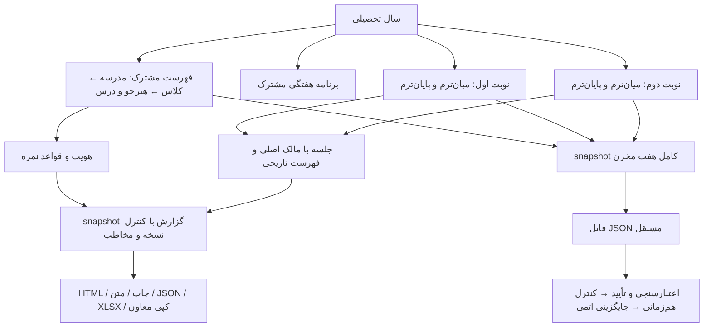

# معماری EduManager

## ساختار نهایی منبع

برنامه یک PWA آفلاین‌محور و بدون backend است. EduManager.html تنها ورودی برنامه است؛ index.html به آن هدایت می‌کند. JavaScript و CSS قابل ویرایش در `src/` قرار دارند؛ خروجی‌های
`assets/scripts/` و `assets/styles/` با `npm run build` تولید می‌شوند.

| مسیر                    | مسئولیت                                                      |
| ----------------------- | ------------------------------------------------------------ |
| `src/domain/`           | محاسبات دقیق نمره، تقویم، CSV، رمز و قواعد امن داده          |
| `src/domain/reporting/` | هستهٔ مشترک و خالص حضور، بازهٔ تاریخ، مدل گزارش و نمرات      |
| `src/data/`             | اتصال IndexedDB، schema، codec و تراکنش ذخیره                |
| `src/validation/`       | صحت پشتیبان کامل، کارنامهٔ ثابت و undo                       |
| `src/ui/`               | تقویم، dialog، پوسته و factory تنظیمات درس                   |
| `src/reports/periodic/` | مدل، بازه، یادداشت، متن، HTML، فیلتر و خروجی گزارش           |
| `src/pwa/`              | manifest و نصب/به‌روزرسانی                                   |
| `src/legacy/`           | صفحات و قراردادهای رابط موجود، تفکیک‌شده به مسئولیت          |
| `src/workspace/`        | سرویس‌های دوره، داده، backup، پیش‌نویس، هم‌زمانی و API عمومی |
| `src/styles/`           | CSS اجزا و قواعد responsive؛ فونت آفلاین                     |
| `scripts/`              | build، کنترل همگامی خروجی و سرور محلی                        |
| `audit/flows/`          | سناریوهای یکپارچهٔ مرورگر                                    |

## نمای روابط

این نمودار مدل محصول است. برای سازگاری با دادهٔ قدیمی، کپی فیزیکی فهرست در رکورد نوبت‌ها باقی است؛ تراکنش مشترک سال آن‌ها را هماهنگ می‌کند. گزارش و فایل پشتیبان دو خروجی با کاربرد مستقل‌اند.

## مرز سال تحصیلی و نوبت

قواعد اشتراک نام مدرسه/کلاس، هویت، عضویت و ترتیب ثبت هنرجو در domain/academic-year-directory.js تعریف شده است. دادهٔ نوبت‌ها با ساختار قبلی نگهداری می‌شود؛ data/academic-directory-transaction.js تغییر مشترک را در یک تراکنش همراه revision، تاریخچه و undo اعمال می‌کند. تعریف درس و برنامهٔ هفتگی در سطح سال مشترک‌اند؛ چهار مرحلهٔ نمرهٔ کاردانش و رکورد اصلی هر جلسه هویت و مقصد مستقل خود را حفظ می‌کنند. workspace/periods/shared-directory.js فهرست‌های ناقص قدیمیِ سازگار را یکپارچه می‌کند؛ تعارض هویت یا ترتیب را به‌صورت خودکار حل نمی‌کند.

پشتیبان عمومی، snapshot کامل یک نصب است. بازیابی کامل جایگزین تمام داده می‌شود. حذف مشترک مدرسه/کلاس فقط فهرست نسخه‌های نوبت‌ها و نشانگر نصب را می‌خواند و نسخهٔ تمام نوبت‌های سال را در لحظهٔ حذف کنترل می‌کند؛ کپی ایمنی عملیات ساخته نمی‌شود و بازگردانی ناقصِ تک‌نوبت برای آن نگهداری نمی‌شود. حذف نوبت و بازیابی کل سیستم نیز نسخهٔ داخلیِ پیش از عملیات نمی‌سازند. پشتیبان کامل دستی و خودکار، کنترل‌های هم‌زمانی و جایگزینی اتمی حفظ شده‌اند.

دفتر نمره از workspace/grading/assessment-context.js برای انتخاب و نوشتن مرحلهٔ مقصد استفاده می‌کند و workspace روزمره را عوض نمی‌کند. workspace/sessions/year-view.js فقط projection نمایشی همهٔ جلسات سال را می‌سازد؛ هیچ session مجازی در بانک ذخیره نمی‌شود. بازکردن سابقه، کنترل دسترسی و مالکیت رکورد اصلی را حفظ می‌کند.

workspace/periods/year-editor.js فقط اطلاعات و ادامهٔ کار همان سال را نمایش می‌دهد؛ ایجاد یا انتخاب سال دیگر در رابط و API عادی وجود ندارد. سوابق چندسالهٔ قدیمی برای سازگاری و پشتیبان حفظ می‌شوند. workspace/reports/year-notes-scope.js منابع مجاز یادداشت سالانه را محاسبه می‌کند؛ یادداشت‌های گزارش غیرسالانه به ترم فعال محدودند و یادداشت نوبت رمزدارِ تأییدنشده وارد رابط نمی‌شود. گزارش فعالیت غیرسالانه snapshot ترم فعال دارد؛ بخش صریح کارنامهٔ سالانهٔ اولیا snapshot و کنترل نسخهٔ سالانهٔ جداگانه دارد. قرارداد کامل در [BUSINESS-RULES.md](BUSINESS-RULES.md) آمده است.

## قرارداد اجرای منابع

`source-map.json` **manifest ساخت** است، نه فایل Source Map استاندارد مرورگر.
ترتیب آن بخشی از قرارداد برنامه است. واحدهای `workspace/` یک scope خصوصی مشترک
دارند؛ state به بیرون نشت نمی‌کند. واحدهای `legacy/` APIهای classic مورد استفاده
توسط رابط موجود را نگه می‌دارند. factory درس و گزارش دوره‌ای نیز scopeهای جدا دارند.
این تفکیک، سازمان‌دهی کامل منبع است؛ تبدیل همهٔ bindingها به ES module مستقل جزو
این تغییر نیست.

### خروجی کم‌حجم و نگاشت دیباگ

`scripts/assemble-bundle.cjs` ترتیب و scope قبلی را به یک منبع خوانا تبدیل
می‌کند؛ build و lint هر دو از همین assembly استفاده می‌کنند. سپس
`scripts/compact-bundle.cjs` با نسخهٔ قفل‌شدهٔ esbuild فقط فاصله‌ها و توضیحات
غیراجرایی خروجی را کم می‌کند. تغییر نام متغیر/تابع، بازنویسی فشردهٔ عبارت‌ها،
tree shaking و تبدیل هدف سازگاری فعال نیستند؛ هدف `esnext` قرارداد مدرن فعلی
را حفظ می‌کند. این فرایند جایگزینِ استقلال واقعی ماژول‌ها یا lazy loading نیست.
تفکیک گزینه‌های فشرده‌سازی در [مستند رسمی esbuild](https://esbuild.github.io/api/#minify)
شرح داده شده است؛ نسخهٔ ابزار در package-lock.json ثابت است.

نگاشت خطی assembly به نگاشت استانداردِ خروجی فشرده ترکیب می‌شود؛ محتوای اصلی
و مسیر فایل‌ها برای دیباگ باقی می‌مانند. lint منبع خوانای اصلی را با scopeهای
واقعی بررسی می‌کند، نه خروجیِ فاقد توضیحات؛ بنابراین دستورهای محدودِ ESLint
و موقعیت دقیق خطای منبع از بین نمی‌روند. تغییر صرفاً توضیحی، نگاشت دیباگ را
به‌روز می‌کند، اما وقتی بایت اجرایی یکسان است شناسهٔ cache را عوض نمی‌کند.

`npm run metrics` اندازهٔ خام و برآورد gzip هر منبع بارگذاری اولیه، شمار توابع
AST و گروه‌های ساخت را بدون تغییر فایل گزارش می‌کند. gzip تخمین محلی است،
نه حجم مشاهده‌شدهٔ HTTP؛ تعداد توابع یا تفکیک فایل نیز درصد بهینگی نیست.

پوستهٔ رابط، تغییرات app، modal، تقویم و سطوح PWA را جداگانه دنبال می‌کند؛
تغییر متن یا محتوای مودال باعث اسکن جدول‌های app نمی‌شود. تغییرهای هم‌زمان
در یک frame جمع می‌شوند، ریشهٔ جایگزین دوباره مشاهده می‌شود و تغییر ناشناختهٔ
body همچنان بررسی کامل دارد. جدول‌های محدودهٔ تغییرکرده، یک بار برای اندازه،
بسته‌بندی و برچسب دسترس‌پذیری جمع‌آوری می‌شوند. این کار رندر کامل قدیمی صفحات
را حذف یا قرارداد رویدادها و داده را تغییر نمی‌دهد.

پوستهٔ HTML هیچ event handler اجرایی inline ندارد. رویدادهای ثابت بستن پنجره و
ورود JSON/CSV در `src/ui/shell-events.js` با `addEventListener` متصل می‌شوند؛
تابع مقصد هنگام رخداد خوانده می‌شود تا ترتیب نصب workspace مشکلی ایجاد نکند.
فرم ورود نیز پس از هر render اتصال مستقل submit می‌گیرد. handlerهای اجرایی inline
از همهٔ منابع برنامه حذف شده‌اند و تست منبع از بازگشت آن‌ها جلوگیری می‌کند.

`legacy/core/events.js` پیش از تقویم و رابط بارگذاری می‌شود. توابع ثبت‌شدهٔ
`legacy/events/`، `ui/events-calendar.js` و `reports/periodic/events-*.js` فقط از
کلیدهای data و پارامترهای escape‌شده استفاده می‌کنند؛ eval یا Function constructor
وجود ندارد. delegation روی ریشه‌های پایدار app، modalBody و calPopup نصب است تا
ترتیب bubbling و stopPropagation تقویم و کنترل‌های تودرتو حفظ شود.
ثبت handler می‌تواند گزینهٔ صریح `{ mutating: true/false }` داشته باشد؛ رویدادهای
پنجرهٔ جلسه از این قرارداد استفاده می‌کنند و تغییر نام تابع، طبقه‌بندی قفل را عوض
نمی‌کند. فقط handlerهای فاقد این گزینه هنوز از تشخیص نام فراخوانی سازگار قدیمی
استفاده می‌کنند. `data-mutating` صریح و ارث‌بری قفل فرم همچنان برقرارند؛ گزینهٔ
`false` برای یک handler این قواعد DOM یا مجوز ذخیره را غیرفعال نمی‌کند.
در کد جدید از `data-mutating` صریح استفاده شود. قالب HTML با CSP اسکریپت inline،
object و تغییر base را محدود می‌کند؛ styleهای inline برای سازگاری باقی‌اند.

دکمه‌های header از `data-header-action` و allowlist خصوصی `src/ui/header-events.js`
استفاده می‌کنند. یک listener روی ریشهٔ پایدار app نصب می‌شود، بنابراین بازسازی
header اتصال تکراری ایجاد نمی‌کند. توکن ناشناخته، دکمهٔ غیرفعال یا داخل inert و
عنصر خارج از header اجرا نمی‌شود. بازیابی فوکوس modal نیز توکن action را می‌شناسد.
بازیابی فوکوس پس از مرحلهٔ زمان‌بندی‌شدهٔ چیدمان پوسته انجام می‌شود تا جابه‌جایی
دکمه در DOM فوکوس را از بین نبرد. منوی بستهٔ موبایل، summary دارای شناسهٔ پایدار
را به‌عنوان مقصد قابل‌دیدن فوکوس نگه می‌دارد.

فرم تنظیمات پس از موفقیت `showModal`، listenerهای submit و انصراف خود را روی
همان نمونهٔ فرم نصب می‌کند. submit جلوی پیمایش مرورگر را می‌گیرد و مستقیماً
سرویس خصوصی `saveSettingsV24` را فراخوانی می‌کند؛ قالب تنظیمات کد inline ندارد.
ردشدن بازکردن modal هیچ listener یا context جدیدی روی فرم فعلی نصب نمی‌کند.

فرم اصلاح عنوان نوبت نیز پس از پذیرش modal، submit و انصراف را روی همان نمونه
متصل می‌کند و کد inline ندارد. ردشدن جایگزینی فرم، context و revision قبلی را
حفظ می‌کند؛ سال همچنان فقط‌خواندنی است و سرویس ذخیره تغییر دوره را بررسی می‌کند.

فرم تعریف/تنظیمات درس نیز handler inline ندارد. فایل خصوصی
`src/ui/course/form-events.js` پس از پذیرش modal، رویدادهای submit، تغییر شاخه،
تغییر روش و انصراف را به همان نمونهٔ فرم متصل می‌کند. خطاهای غیرهم‌زمان ذخیره
به presenter موجود فرم می‌روند.

کنترل معیارهای الزامی جدول نمرات از `data-lesson-id`، `data-pod-id` و
`data-student-id` استفاده می‌کند؛ همهٔ مقدارها هنگام تولید HTML escape می‌شوند.
یک listener خصوصی در `src/ui/course/table-events.js` روی modalBody پایدار نصب
می‌شود و با بازسازی جدول باقی می‌ماند. کنترل غیرفعال، inert، نامرتبط یا فاقد
شناسه نادیده گرفته می‌شود و خطای ذخیره به presenter موجود می‌رود.

ورودی‌های تولیدشده با `gradeCell` و دکمهٔ پاک‌کردن آن‌ها کد inline ندارند.
`src/workspace/grading/events.js` یک بار در `installUI` به document متصل می‌شود؛
input به سرویس پیش‌نویس، focusout به flush و کلیک پاک‌کردن به مسیر تأیید موجود
می‌رود. focusout برخلاف blur قابل delegation است. ورودی‌های غیرفعال، inert و
نامرتبط نادیده گرفته می‌شوند؛ سایر فرم‌های قدیمی خارج از این قراردادند.

ماژول‌های مستقل دامنه، validation و data، مسئولیت‌های مشخص و تست‌های جدا دارند.
بخش‌های سازگار legacy/workspace هنوز از توابع مشترک استفاده می‌کنند؛ وابستگی‌های آن‌ها
از طریق ترتیب build حفظ می‌شود. فایل خروجی بزرگ، محل نگه‌داری کد نیست.

## هستهٔ مشترک گزارش و کارنامه

`assets/scripts/reporting-core.js` از چهار منبع مستقل در `src/domain/reporting/`
ساخته می‌شود و در HTML برنامه دقیقاً یک بار، پس از `grade-policy.js` و پیش از
مصرف‌کننده‌های گزارش، بارگذاری می‌شود. این بسته محاسبات دامنه را مستقل از DOM و بانک نگه می‌دارد:

- `attendance.js` و API ثابت `EduReportAttendance`: نرمال‌سازی وضعیت، شمار مشاهده
  و نرخ حضور. `summarizeObservations` فقط شناسه‌های مرجعِ ازپیش‌تطبیق‌یافته می‌گیرد؛
  اشخاص، مشاهدات و نفرـروز را جدا می‌شمارد و تعارض یک مشاهده را رد می‌کند.
  حاضرِ روزانه شامل تأخیر است؛ غیبت روزانه یعنی حداقل یک مشاهدهٔ غیبت، نه غیبت
  قطعی تمام روز. این تجمیع هنوز جایگزین بانک و گزارش چندمنبعی نسخهٔ ۱ نشده است.
- `date-ranges.js` و `EduReportDates`: اعتبارسنجی ISO و بازهٔ روز، هفتهٔ شنبه تا
  جمعه، ماه شمسی و سال؛ بدون خواندن تاریخ انتخاب‌شده یا ساعت سیستم.
- `periodic-model.js` و `EduReportModel`: projection دادهٔ صریح با مخاطب مشخص و
  زمان ساخت اجباری `generatedAt`. محدودسازی والدین پیش از شمارش و ساخت خروجی
  انجام می‌شود؛ هیچ فهرست پنهانی از دیگر هنرجویان به مدل فردی افزوده نمی‌شود.
  `collisionScope` محدودهٔ تداخل را صریح می‌کند: `class` برای کلاس‌های موازی
  مدرسه و `teacher` برای یک دبیر؛ آداپتور دبیر حتماً دومی را می‌دهد تا کنترل
  جلسات هم‌زنگ او در کلاس‌های مختلف تضعیف نشود.
- `academic-results.js` و `EduReportGrades`: وزن، مؤلفه‌ها و نتیجهٔ هر مرحله،
  نتیجهٔ سالانه از چهار مرحلهٔ خام با حساب دقیق و نتیجهٔ پودمانی سالانه با همان
  `EduPolicy`. صفر، نمرهٔ ناقص و قرارداد قدیمیِ بدون policy معنای قبلی را دارند.

آداپتور `src/reports/periodic/model.js` زمان را از میزبان می‌گیرد؛ context، امضای
گزارش، یادداشت، snapshot و محافظ مقصد همچنان در میزبان‌اند. آداپتور دفتر نمره به محاسبات نمرهٔ مشترک متصل است. اعتبارسنجی تبادل قدیمی معاون برای سازگاری باقی است؛ در این شاخه کارتابل یا مسیر ارسال فعال معاون وجود ندارد.

## ذخیره‌سازی

عملیات خواندنیِ غیرهم‌زمان که پنجره باز می‌کنند، با `core/async-target.js` مقصد
خود را حفظ می‌کنند. خوانایی اطلاعات و ثابت‌ماندن شناسهٔ دوره پس از انتظار بررسی
می‌شود؛ برای نمرات گروهی، مدرسه و کلاس انتخاب‌شده هم باید ثابت بمانند. تغییر
revision ناشی از ذخیرهٔ خود پنجره مجاز است؛ این محافظ جای snapshot دقیق گزارش‌ها نیست.
فهرست پشتیبان‌ها پس از دریافت ردیف‌ها و برآورد فضای مرورگر نیز مقصد را کنترل می‌کند.

دادهٔ اصلی دوره‌ها در IndexedDB ذخیره می‌شود. schema شامل records، catalog، events،
undo، backups، reports و drafts است. localStorage برای مهاجرت، ترجیح دوره و نسخهٔ
قابل‌بازیابی پیش‌نویس‌ها استفاده می‌شود.

codec رکوردها مالکیت و چیدمان دوره را بررسی می‌کند. برنامهٔ ذخیره، تفاوت رکوردها را
بدون تغییر ورودی می‌سازد؛ تراکنش records/catalog/events/undo آن را با بررسی revision
اتمیک ثبت می‌کند. هر نوشتن اتمیک، epoch نصبِ ثبت‌شده در آغاز عملیات را نیز درون
همان تراکنش با نشانگر پایدار نصب تطبیق می‌دهد تا تب قدیمی نتواند دادهٔ نصب
جایگزین‌شده را بازنویسی کند. state حافظه فقط پس از موفقیت تراکنش تغییر می‌کند.

`src/domain/revision.js` در بستهٔ موجود `data-store-runtime` پیش از مصرف‌کنندگان
بارگذاری می‌شود. `EduRevision.next` فقط عدد صحیح امن و نامنفی را دقیقاً یک واحد
جلو می‌برد؛ مقدار نامعتبر یا ظرفیت تمام‌شده خطای دامنه است. نویسندگان catalog،
نوبت همراه و سیاست درس، ظرفیت افزایش لازم را پیش از نوشتن کنترل می‌کنند؛ شکست
در تغییر چندنوبتی کل تراکنش را برمی‌گرداند. بازیابی کامل، علاوه بر افزایش نسبت به
نسخهٔ فایل و نسخهٔ زنده، ظرفیت یک ویرایش بعدی را نیز نگه می‌دارد. اعتبارسنجیِ
پشتیبان آرشیوی با `Number.MAX_SAFE_INTEGER` همچنان خواندنی است؛ ظرفیت نوشتن هنگام
بازیابی جدا کنترل می‌شود. مخزن یا schema تازه‌ای ساخته و شمارنده‌ای بازنشانی نمی‌شود.

پشتیبان نسخه‌های ۱/۲ و schemaهای ۲۵/۲۶، کارنامه‌های قدیمی و پیش‌نویس‌های نیازمند
بازبینی پشتیبانی می‌شوند. تغییر قرارداد داده نیازمند migration افزایشی و تست است.

### پشتیبان کامل و فایل خودکار

خروجی کامل JSON به‌صورت فشرده، با همان `format: EduManager.FullBackup`،
`version: 2` و `schemaVersion: 26` نوشته می‌شود؛ فشرده‌سازیِ فاصله‌ها قرارداد
داده یا محتوای تاریخی را تغییر نمی‌دهد. `validateFullBackup.prepare` برای
پیش‌نمایش، یک نسخهٔ جداشدهٔ نرمال‌شده و دادهٔ خوانده‌شدهٔ نوبت‌ها را در یک
مرحلهٔ اعتبارسنجی برمی‌گرداند. اعتبارسنجی پیش از جایگزینی تخریبی دوباره اجرا
می‌شود؛ نتیجهٔ قبلی مجوز اعتماد به ورودیِ قابل‌تغییر نیست.

snapshot در یک تراکنش خواندنی گرفته می‌شود. مخزن `backups` با cursor خوانده
می‌شود تا بدنهٔ نسخه‌های کاملِ قدیمی هم‌زمان در نتیجه جمع نشود؛ ردیف‌های
`full` به‌صورت تودرتو وارد فایل معمولی نمی‌شوند. این فیلتر حذف از دیسک نیست.
snapshotهای عادیِ تاریخی، از جمله سوابق مهاجرت یا نوبت حذف‌شده، حفظ می‌شوند؛
سیاست نگه‌داری نسخه‌های قبلی در این بهینه‌سازی تغییر نکرده است. پیش‌نویس امنِ
نامعتبر یا بلند بدون کوتاه‌سازی حفظ می‌شود؛ انتخاب نسل جدید و نشان حذف، پیش از
بررسی محتوا انجام می‌شود تا نسخهٔ قدیمی دوباره زنده نشود.

فایل خودکار برای تشخیص تغییر از امضای همان منبع snapshot استفاده می‌کند:
epoch نصب، ترم فعال و catalog/revision نوبت‌ها، پیش‌نویس‌های بانک/حافظه/محلی،
یادداشت‌ها، هویت فرستنده و کلیدهای تاریخچه، پشتیبان، undo و کارنامهٔ ثابت.
مقدار updatedAt ردیف پیش‌نویس و metadata اتصال فایل، به‌تنهایی تغییر محتوای
پشتیبان نیستند.
poll یا debounce خودکارِ بدون تغییر، snapshot کامل و بازنویسی فایل انجام
نمی‌دهد؛ «ذخیره اکنون / اجازه مجدد» همچنان ذخیرهٔ صریح و تازه را درخواست می‌کند.
امضای ذخیره‌شده به snapshot نوشته‌شده تعلق دارد؛ تغییر حین نوشتن برای ذخیرهٔ
بعدی باقی می‌ماند. تغییر بیرونی فایل یا epoch نصب همچنان پیش از نوشتن کنترل
می‌شود.

اتصال فایل پس از بازیابی کامل، با شناسهٔ تازه و تعلیق پایدار نگه داشته می‌شود؛ بازشدن دوبارهٔ برنامه تعلیق را رفع نمی‌کند. ادامهٔ انتشار فایل، تأیید صریحِ جایگزینی همان نام فایل را می‌خواهد. شمار محتوای آخرین نوشتن موفق در metadata اتصال نگه‌داری می‌شود؛ اتصال قدیمیِ بدون این metadata، مبنا را از فایل قبلیِ تغییرنکرده می‌خواند. تشخیص کاهش شدید، پیش از createWritable نوشتن را متوقف می‌کند؛ مجوز مرورگر به‌تنهایی تأییدِ جایگزینی پس از بازیابی نیست. این فایل همچنان آینهٔ فعلی داده است، نه تاریخچهٔ نسخه‌ها یا حفاظت از خرابی دستگاه.

امضای سبک فرض می‌کند بدنهٔ ردیف‌های تاریخی و کارنامه/پشتیبان با شناسهٔ ثابت
تغییر نمی‌کند؛ تغییر کلیدها یا revision catalog تغییر را نمایان می‌کند. هر
قرارداد جدید برای تغییر بدنهٔ ردیف موجود باید revision نوبت مربوط را افزایش
دهد یا آن محتوا را صریحاً وارد امضا کند. ذخیرهٔ خودکار فایل فقط هنگام باز بودن
برنامه، در مرورگر پشتیبان API فایل و با مجوز نوشتن فعال است؛ اجرای منظم آن در
حالت بسته یا تعلیق دستگاه تضمین نمی‌شود.

تغییر سیاست نگه‌داری طبق درخواست کاربر به تعویق افتاده است؛ پیشنهاد اجرانشده:
شمارش و فهرست نامزدهای حذف فعلی حفظ شود؛ محافظت از نسخه‌های مهاجرت،
سوابق نوبت حذف‌شده و نوع‌های ناشناخته فقط به آن اضافه شود.
این روش هنوز می‌تواند هنگام ذخیرهٔ پشتیبان تازه، نسخه‌های عادی قدیمی
خارج از شمارش فعلی ۸ نسخه را حذف کند؛ پاک‌سازی در نصب یا به‌روزرسانی
اجرا نمی‌شود. فیلتر پیشنهادی فقط از مجموعهٔ حذف قبلی کم می‌کند؛
در ۱۰هزار تاریخچهٔ مصنوعی، گسترش مجموعهٔ حذف صفر بود.

## گزارش و سازگاری تاریخی

گزارش HTML، متن، JSON، XLSX و کپی معاون از مدل محدودشدهٔ همان مخاطب و snapshot کنترل‌شده تولید می‌شوند. چاپ روی clone انجام می‌شود و تاگل‌های جزئیات را در همان clone باز می‌کند؛ نمایش جاری تغییر نمی‌کند. خروجی XLSX در مرورگر با ZIP/XML محلی ساخته می‌شود؛ بازیابی بانک از XLSX یا JSON گزارش انجام نمی‌شود.

ریز واحدهای کارِ پودمانی، برخلاف نتیجهٔ رسمی سالانهٔ پودمان، از تمام نوبت‌های همان سال با term و sourcePeriodId مستقل جمع می‌شوند؛ ترتیب از termKind پیروی می‌کند و عنوان تاریخی محفوظ است. اکسل عمومی برای هر واحد، نوبت واقعیِ همان ورودی را می‌نویسد. محافظ finalText فقط نمایش گمراه‌کنندهٔ نزدیک حدنصاب را به متن توضیح‌دار تبدیل می‌کند؛ اعداد معمولی همچنان عدد و مقدار ثبت‌نشده خالی است.

یادداشت‌ها در localStorage می‌مانند، ولی انتشارشان از مسیر persistReportNotes و تراکنش records با کنترل epoch نصب می‌گذرد. guard بازیابی، امضای خام یادداشت‌ها را در مرز تراکنش جایگزینی دوباره می‌سنجد. صف حافظه، نسخهٔ هر کلید و نسل reset، نوشتهٔ تازه را از تکمیل درخواست قدیمی محافظت می‌کنند؛ getDrafts مقادیر در انتظار را نیز برای پشتیبان برمی‌گرداند. flushNotes پایان نوشتن را انتظار می‌کشد و تا وجود ورودی ناتمام، موفقیت اعلام نمی‌کند.

کارتابل مستقل معاون و فایل‌های اجرایی آن حذف شده‌اند. اعتبارسنجی deputy-exchange و deputy-export-identity تنها برای سازگاری فایل‌های قدیمی و پشتیبان حفظ شده است. شناسهٔ بانک دبیر و هفت مخزن آن تغییر نکرده‌اند.

## انتشار و آفلاین

build خروجی‌های منبع، فهرست cache و شناسهٔ انتشار سرویس‌ورکر را تولید می‌کند.
شناسه از HTML، manifest، منطق service worker و JavaScript/CSSهای لازم برای اجرا
ساخته می‌شود؛ تغییر این وابستگی‌ها شناسه را عوض می‌کند. فقط منابع لازم برای اجرا
در cache اجباری نصب قرار دارند؛ فایل‌های دیباگ `assets/**/*.map` اختیاری‌اند و
نبودشان آمادگی آفلاین را متوقف نمی‌کند. نصب ناقص، cache نسخهٔ فعال را حذف نمی‌کند.

هر منبع دانلودشده پیش از ورود به cache با MIME مورد انتظار و SHA-256 همان
انتشار کنترل می‌شود؛ پاسخ خطا، redirect یا محتوای نامرتبط پذیرفته نمی‌شود.

PNGهای ارجاع‌شده از HTML و آیکن‌های محلی manifest نیز در allowlist همین برنامه‌اند؛
ارجاع پویای تصویر باید preload ایستای HTML یا ارجاع manifest داشته باشد تا از
cache و بستهٔ انتشار جا نماند. تصاویر و MIME آن‌ها صریح‌اند و پیمایش عمومی پوشهٔ
assets وجود ندارد. اثرانگشت PNG از بایت خام محاسبه و با ArrayBuffer پاسخ کنترل
می‌شود؛ فقط متن هم‌ارزی LF/CRLF دارد. تبدیل تصویر به UTF-8 در build، ابزار
ارتقای PWA یا worker، بایت‌ها و اعتبارسنجی آفلاین را خراب می‌کند.

دانلود اولیه حداکثر چهار درخواست هم‌زمان دارد. منبع اجراییِ مفقود از cache در
حالت آنلاین از همان نسخه دوباره دریافت و اعتبارسنجی می‌شود؛ درخواست‌های هم‌زمان
ترمیم یک نشانی به یک کار مشترک متصل می‌شوند.

خط‌پایان متن پیش از هش به LF یکسان می‌شود. VERSION هنگام محاسبهٔ هش مقدار
قراردادی دارد تا چرخهٔ هش ایجاد نشود؛ FILES و INTEGRITY از فهرست منابع اجرایی
و SHA-256 آن‌ها تولید می‌شوند. فایل `source-map.json`
manifest ساخت است؛ فایل‌های `assets/**/*.map` نگاشت استاندارد دیباگ مرورگرند.
API عمومی در `src/legacy/core/runtime-facade.js` ثابت می‌ماند؛ پیاده‌سازی workspace
فقط یک بار از طریق `EduRuntimeAPI.install` نصب می‌شود و توابع عمومی بازنویسی نمی‌شوند.

`npm run build:check` بدون نوشتن، خروجی قدیمی یا فایل منبع ثبت‌نشده را رد می‌کند.
برای GitHub Pages فایل‌های خروجی همراه HTML، manifest و service worker منتشر شوند.
npm run release:package خروجی allowlist را در dist می‌سازد؛ انتشار باید از همین بسته باشد، نه کل ریشهٔ مخزن. docs/School-doc در درخت فعلی وجود ندارد و شمار فایل‌های رهگیری‌شدهٔ این مسیر صفر است، اما تاریخچهٔ Git هنوز دو commit مرتبط با آن دارد. حذف فعلی، پاک‌سازی تاریخچه نیست؛ در صورت عمومی‌بودن یا عمومی‌شدن مخزن، دسترسی به دادهٔ پیشین و تاریخچه نیازمند بررسی جداست. بسته‌بندی dist تاریخچه را تغییر نمی‌دهد و این بررسی نیز آن را بازنویسی نکرده است. اجرای تنها HTML کپی‌شده کافی نیست. CI پس از موفقیت آزمون و بسته‌بندی، فقط برای master مخزن اصلی محتوای dist را به GitHub Pages می‌فرستد و منتشر می‌کند. شکست بررسی، انتشار را متوقف می‌کند؛ فقط نتیجه‌ها و تصاویر مصنوعی آزمون از مسیرهای صریحِ مجاز، با نگه‌داری سه‌روزه و جدا از بستهٔ Pages قابل دریافت‌اند.

## قرارداد رنگ رابط

`src/styles/product-tokens.css` منبع مشترک رنگ‌هاست؛ منوهای زغالی، اقدام‌های قرمز،
تأکید کهربایی، سطح سفید و ورودی خاکستری روشن از پالت محلی Reactium گرفته شده‌اند.
قرمز برند `#ed1c24` با قرمز تعاملی `#c0141b` تفکیک شده تا نوشتهٔ سفید کوچک روی
دکمه‌ها کنتراست کافی داشته باشد. کهربایی روشن نوشتهٔ تیره دارد؛ حضور، غیبت،
تأخیر، مرخصی و وضعیت نامشخص، نقش‌های معنایی مستقل `--status-*` دارند.

متغیرهای سازگار قدیمی به همین نقش‌ها اشاره می‌کنند؛ نباید در لایه‌های مؤلفه،
`--theme-surface` و `--theme-field` دوباره به alias یکدیگر متصل و چرخه ایجاد شوند.
رنگ خط ورودی و focus از خط تزئینی کارت جداست. توکن‌ها در چاپ هم تعریف شده‌اند؛
قواعد responsive، ترتیب فرم‌ها، محاسبات، schema و قراردادهای داده تغییر نکرده‌اند.
رنگ‌های چاپ با پشتیبانی و تنظیم چاپ پس‌زمینهٔ مرورگر نمایش داده می‌شوند.

`npm run test:theme` با دادهٔ ساختگی و پروفایل موقت، نماهای برنامه را در موبایل،
تبلت و دسکتاپ ثبت می‌کند و overflow، رنگ محاسبه‌شدهٔ واقعی متن و مقدار ورودی،
مرز کنترل، focus و hover را می‌سنجد. آزمون‌های واحد قرارداد توکن‌ها نیز همراه
`node --test` اجرا می‌شوند. آزمون تم به دروازهٔ `check:release` افزوده شده است؛
این بررسی جای پذیرش روی دستگاه فیزیکی یا قضاوت انسانی دربارهٔ ظاهر را نمی‌گیرد.

## راستی‌آزمایی

ثبت تکی، گروهی و انتقال حضور، دکمه‌های همان پنجرهٔ جلسه را به‌روز می‌کنند؛
افزودن/حذف فعالیت فقط ردیف‌های تغییرکردهٔ جدول را اصلاح می‌کند. سازندهٔ اولیه
و به‌روزرسانی موضعی از markup مشترک استفاده می‌کنند. هویت رکوردها فقط در حافظهٔ
رابط نگهداری می‌شود و schema یا پشتیبان تغییر نمی‌کند. به‌روزرسانی پس از ذخیرهٔ
موفق و اعتبارسنجی همان مجوز ویرایش، بانک، نصب و اتصال است؛ خطای ذخیره فرم را
پاک نمی‌کند. بازگشایی و تغییر ساختاری تاریخ/واحد همچنان رندر کامل دارند.

`npm test` ساخت، تست واحد، قرارداد داده و asset و مرورگر ایزوله را بررسی می‌کند.
آزمون مرورگر شامل import/restore، گزارش، تعارض تب‌ها، undo و ارتقای واقعی PWA است.
profile شخصی و دادهٔ واقعی کاربر وارد آزمون نمی‌شوند.

پذیرش فیزیکی Android با Chrome و Samsung Internet و iPhone با Safari هنوز انجام
نشده است؛ شبیه‌سازی اندازهٔ موبایل در Edge، آزمون این دستگاه‌ها نیست. گردش‌کار
پذیرش در [README](../README.md#پذیرش-روی-دستگاه-واقعی) ثبت شده است: نصب روی HTTPS،
اجرای سرد آفلاین، صفحه‌کلید و فوکوس، دریافت واقعی JSON در Downloads/Files و بازیابی
آن در فضای آزمایشی جدا، انتخابگر بومی فایل در صورت وجود، اشتراک و لغو آن و ارتقای
نسخه با حفظ داده و هویت نصب. برای هر مورد باید دستگاه، نسخهٔ مرورگر و نتیجه ثبت شود.
bindingهای classic و scopeهای مشترک سازگار باقی‌اند؛
این کار تبدیل سراسری به ES module یا مهاجرت framework نیست.

آزمون `npm run test:annual-backup` در دروازهٔ انتشار و CI، یک سال تحصیلی مصنوعی با
دو نوبت، ۱۰۰ هنرجو و ۵۱۲ جلسه را در پروفایل جداگانهٔ Edge می‌آزماید.
فایل JSON واقعاً در مسیر موقت دانلود و از ورودی فایل برنامه بازیابی می‌شود.
مقایسه، ترتیب آرایه‌ها، پشتیبان داخلی، undo، کارنامهٔ ثابت، یادداشت و پیش‌نویس
را شامل می‌شود؛ تغییرات عملیاتی مجاز مثل revision و توکن نصب جداگانه
کنترل می‌شوند. پیش‌نمایش بدون تغییر داده، بازیابی دوباره و بارگذاری آفلاین
نیز بررسی می‌شوند. فایل پشتیبان مصنوعی و `metrics.json` در مسیر موقت گزارش‌شده
باقی می‌مانند؛ زمان‌ها مختص رایانهٔ آزمون هستند.

`npm run check` کنترل Prettier، ESLint با scope واقعی برنامه و تمام آزمون‌ها را
اجرا می‌کند. قواعد متغیر استفاده‌نشده در برنامهٔ classic به‌دلیل APIهای عمومی
رابط اعمال نمی‌شوند؛ در ابزارها و آزمون‌ها فعال‌اند. قفل نسخهٔ ابزارها در
`package-lock.json` است؛ CI از `npm ci` و Node 22 استفاده می‌کند.
