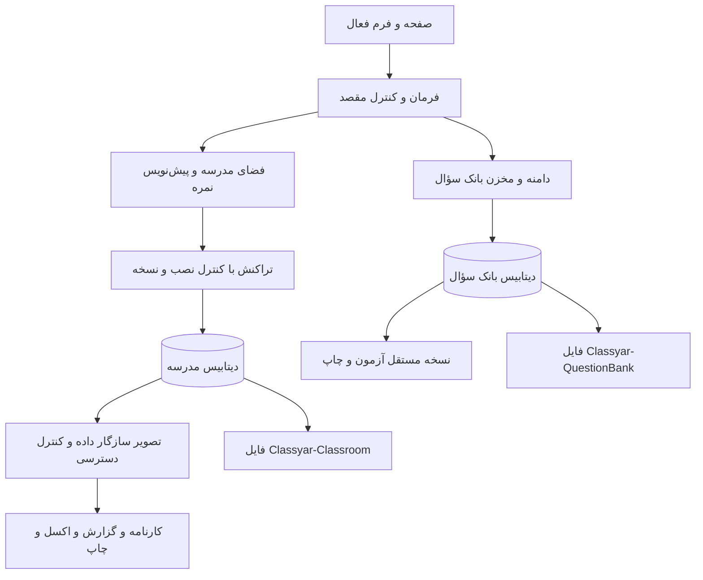

# ممیزی نسخهٔ فعلی کلاس‌یار — ۲۰۲۶/۱۱/۱۸

## دامنه و مبنا

مبنای شروع، commit `97b16b5` با working tree پاک بود. این ممیزی معماری آفلاین فعلی و قراردادهای [کسب‌وکار](BUSINESS-RULES.md) را بررسی می‌کند. قابلیت تازهٔ لایسنس، حساب کاربری یا نقش‌های چندکاربره به محصول اضافه نشده است.

فهرست منبع شامل ۲۴۲ فایل در `src` است: ۲۴۱ منبع ساخت و یک README. بررسی شامل کنترل خودکار تمام منابع ساخت، بازبینی دستی مسیرهای پرخطر، بررسی روابط ماژول‌ها، سناریوهای مصنوعی مرورگر و بازبینی تصاویر رابط است. تعداد فایل‌ها به معنای ادعای بازبینی دستی تک‌تک خطوط یا اثبات نبود تمام خطاهای ممکن نیست.

[فهرست منابع، تعداد خطوط و اثرانگشت هر فایل](FINAL-AUDIT-2026-11-18.sources.json) نسخهٔ دقیق کد بررسی‌شده را ثبت می‌کند؛ اثرانگشت به معنای پوشش دستی هر خط نیست.

دادهٔ واقعی کاربر، فایل‌های پشتیبان شخصی و پروفایل مرورگر او در آزمون‌ها استفاده یا تغییر داده نشد. آزمون‌ها با دادهٔ مصنوعی، سرور loopback و پروفایل‌های جداگانه اجرا شدند.

## یافته‌های قطعی و اصلاحات

چهار دسته نقص با شدت متوسط بازتولید شدند. نقص بحرانی یا شدیدِ تازه‌ای که منجر به فساد داده در سناریوهای بررسی‌شده شود تأیید نشد.

| شناسه | سناریوی قبل از اصلاح                                                                                                                         | نتیجهٔ اصلاح                                                                                                                                                                                                                              |
| ----- | -------------------------------------------------------------------------------------------------------------------------------------------- | ----------------------------------------------------------------------------------------------------------------------------------------------------------------------------------------------------------------------------------------- |
| F01   | کلیک کپی درس، انتظار برای ذخیرهٔ پیش‌نویس، سپس تغییر ترم/کلاس/صفحه: کپی می‌توانست از مقصد جدید ساخته شود. بررسی نوشتن فقط پیش از انتظار بود. | مقصد، اتصال، نصب و داده پیش از انتظار ثبت و پس از هر مرز لازم دوباره بررسی می‌شوند. بررسی تا بازشدن فرم واقعی کپی ادامه دارد؛ ذخیرهٔ عادی پیش‌نویس و تغییر revision همچنان مجاز است. معیار قدیمی پودمان نیز از همین محافظ استفاده می‌کند. |
| F02   | انتخاب فایل مدرسه پیش از تغییر نصب یا تب، سپس پاسخ دیرهنگام انتخابگر: اتصال تازه می‌توانست با انتخاب قدیمی جایگزین شود.                      | عملیات دستی به نصب، اتصال و عمر تب تعلق دارد؛ تعویض تب و برگشت، درخواست قدیمی را معتبر نمی‌کند. نسخهٔ اتصال در تراکنش کنترل می‌شود. ذخیرهٔ خودکار به بازبودن صفحه وابسته نمی‌شود.                                                         |
| F03   | انتخاب فایل، اجازهٔ نوشتن یا قطع اتصال بانک سؤال پس از ترک تب: عملیات معلق می‌توانست همچنان فایل یا تنظیم اتصال را تغییر دهد.                | انتخاب، ذخیرهٔ دستی و قطع اتصال محافظ عمر صفحه دارند. بررسی پیش از ثبت تنظیمات داخل تراکنش نیز تکرار می‌شود؛ تراکنش منتظر، مجوز قدیمی را دوباره زنده نمی‌کند. جریان ناتمام پیش از شروع بستن فایل لغو می‌شود.                              |
| F04   | فشردن Escape با نمرهٔ ذخیره‌نشده، سپس بازشدن فرم دیگر پیش از پایان ذخیره: درخواست قبلی فرم جدید را می‌بست.                                   | درخواست بستن فقط همان محتوای پنجرهٔ اصلی را می‌بندد. فرم جایگزین، بدنهٔ جایگزین و پنجرهٔ از قبل بسته‌شده حفظ می‌شوند؛ خطای ذخیره نیز فرم را باز نگه می‌دارد.                                                                              |

تغییرات محصول در مسیرهای `src/ui/course`، `src/workspace/core/start.js`، `src/workspace/backups`، `src/workspace/ui/install.js` و سه فایل `backup-ui.js`، `file-backup.js` و `repository.js` بانک سؤال قرار دارند. تست‌های بازگشت متناظر در `audit` اضافه یا تکمیل شدند.

## روابط و مرزهای بررسی‌شده

گزارش و پشتیبان کاربرد جدا دارند. بازیابی کامل مدرسه جایگزینی اتمی همان بانک است؛ ورود اکسل سؤال، افزودن کنترل‌شده به بانک سؤال است. شناسهٔ مشابه یا نام ظاهراً صحیح فایل جای کنترل قالب، نصب و revision را نمی‌گیرد. نمایش فرم نیز به‌تنهایی مجوز اجرای عملیات نیست.

## ماتریس بازبینی ماژول‌ها

| حوزه                | قواعد و اتصال‌های بررسی‌شده                                                                                | شواهد                                               |
| ------------------- | ---------------------------------------------------------------------------------------------------------- | --------------------------------------------------- |
| هسته و ساخت         | ترتیب منابع، scopeهای مشترک، تولید خروجی، اثرانگشت فایل‌ها و allowlist بستهٔ انتشار                        | build، lint، قرارداد فایل‌های برنامه و تست ساخت     |
| داده و اعتبارسنجی   | هفت مخزن مدرسه، کدگذاری، تراکنش‌های مشترک، revision و installation، برگشت پس از خطای نوشتن، بازیابی و undo | تست‌های داده و ذخیره، سناریوهای بازیابی و چندپنجره  |
| سال و نوبت          | فهرست مشترک سال، چهار مرحلهٔ ارزشیابی، ادامهٔ نوبت دوم، سوابق قدیمی و نوبت بسته                            | تست‌های سال، ویرایشگر سال و حذف نوبت                |
| مدرسه، کلاس و هنرجو | ایجاد و ویرایش، هویت و ترتیب، کد یکتا، CSV، انتقال/کپی/بایگانی، فهرست تاریخی جلسه                          | تست‌های موجودیت، عضویت، ورود گروهی و فرم‌های مرورگر |
| تعریف درس           | روش عمومی/نظری‌عملی/پودمانی، قفل ساختار دارای سابقه، نام پودمان و واحد، کپی بدون انتقال نمرات              | تست‌های سازگاری سال، قرارداد درس و رگرسیون F01      |
| نمرات               | صفر در برابر خالی، اعشار، وزن عملی/نظری، چهار مرحله، مستقل‌بودن ثبت هر واحد کار، پیش‌نویس و بازیابی        | تست‌های محاسبه، دفتر نمره، پودمان و واحد کار        |
| برنامه و جلسه       | برنامهٔ عادی/فرد/زوج، مبنای هفته، تداخل، ایجاد جلسه، مجوز ویرایش و فهرست اعضای جلسه                        | آزمون‌های برنامه، جلسه و week-settings              |
| حضور و پیگیری       | حاضر/غایب/مرخصی/تأخیر، جلسهٔ برگزارنشده، بازه و شمارش نفرـجلسه                                             | تست‌های دامنه، reminders و بازبینی رابط             |
| گزارش و کارنامه     | snapshot پایدار، دامنهٔ ترم و سال، گزارش یک هنرجو، کارنامهٔ ثابت، توضیحات و خروجی معاون                    | تست‌های reporting، scope، snapshot و مرورگر         |
| اکسل و چاپ          | دادهٔ واقعی، حفظ صفر و دقت، واحد کار، صفحات ادامه، اشتراک‌گذاری و رد خروجی منقضی                           | تست‌های workbook، گزارش، کارنامه، PDF و اشتراک      |
| بانک سؤال           | درس/بخش، چهار نوع سؤال، بارم صدمی، ترکیب و تعداد، آزمون بدون تکرار، بارم هدف، snapshot مستقل               | آزمون‌های domain، business و مرورگر بانک            |
| ورود سؤال           | XLSX معتبر، سقف اندازه/ردیف، فرمول و ZIP نامعتبر، پیش‌نمایش، تکراری‌ها، ثبت افزایشی اتمی                   | تست‌های import و فایل الگو                          |
| پشتیبان             | جداسازی دو بانک، نام و محتوا، فایل شماره‌دار، مجوز، ذخیره دستی/خودکار، حذف فایل و اطلاعات همان بخش         | تست‌های فایل، پشتیبان مشترک و رگرسیون F02/F03       |
| رابط و دسترس‌پذیری  | عرض‌های موبایل تا دسکتاپ، تراز و اندازهٔ کنترل‌ها، فرم قفل‌شده، تقویم، focus، Escape و خروج از پیش‌نویس    | مرورگر، تصاویر رابط، تست‌های رویداد و F04           |
| امنیت سمت مرورگر    | اعتبارسنجی ورودی/پشتیبان، escape محتوا، فرمان‌های ثبت‌شده به‌جای اجرای متن، کنترل دسترسی هنگام عملیات      | lint و تست‌های rendering، validation و context      |
| PWA و انتشار        | نصب آفلاین، خرابی دانلود، حفظ نسخهٔ قبلی، ارتقا با چندپنجره، حفظ معنای دادهٔ قبلی، بستهٔ مجاز              | تست ارتقای دو نسخه و کنترل انتشار                   |

## نتیجهٔ اجرای نهایی

فرمان کامل `npm run check:release` پس از ساخت خروجی اصلاح‌شده، از ابتدا تا انتها با **exit code 0** تمام شد. گزارش اجرای پایه و اجرای نهایی جدا نگهداری شدند. اجرای نهایی شامل قالب‌بندی، lint، تست‌های واحد، قرارداد فایل‌ها و داده، گردش کار جامع و تمام مجموعه‌های اختصاصی فرمان انتشار است.

| کنترل                                  | نتیجهٔ نهایی                                                                 |
| -------------------------------------- | ---------------------------------------------------------------------------- |
| تست‌های واحد                           | ۳۰۸۹ موفق، صفر ناموفق؛ ۶۲ تست بیشتر از مبنای شروع                            |
| مجموعه‌های مرورگر                      | ۱۸ اجرا، ۷۸۱۷ معیار موفق، صفر ناموفق                                         |
| گردش کار جامع                          | ۲۳۸۵ معیار موفق، شامل ارتقای آفلاین دو نسخه                                  |
| بانک سؤال / بیزینس بانک / ورود اکسل    | به‌ترتیب ۵۳۸ / ۲۸۳ / ۲۴۷ معیار موفق                                          |
| پشتیبان مشترک                          | ۳۰۱ معیار موفق؛ دو سناریوی جدید انتخابگر معلق با کلیک واقعی و فایل OPFS قبلی |
| ثبت نمرات واحد کار / کارنامهٔ واحد کار | به‌ترتیب ۲۵۵ / ۳۴۵ معیار موفق                                                |
| قالب‌بندی، lint، ساخت و قراردادها      | موفق                                                                         |
| metrics و benchmark                    | موفق؛ حدود سنجش در بخش بعد آمده است                                          |
| `npm run release:package`              | موفق؛ ۸۱ فایل مجاز در `dist`                                                 |

مجموع معیارهای مرورگر شامل بررسی‌های پایهٔ مشترک در هر اجرای ایزوله است؛ ۷۸۱۷ سناریوی یکتای مستقل ادعا نمی‌شود. تمام ۱۸ گزارش نهایی اثرانگشت اجرای یکسان `9d0c5b2549425000` دارند و نسخهٔ cache خروجی `8894b01d08e3d7cb` است. پروفایل مرورگر هر ۱۸ اجرا پس از پایان پاک شده و گزارش‌ها حفظ شده‌اند.

شواهد قابل بازبینی:

- [خلاصهٔ ماشین‌خوان نتایج مرورگر](FINAL-AUDIT-2026-11-18.results.json)
- [لاگ فرمان کامل انتشار](../.cache/final-audit-release.log)
- [لاگ بسته‌بندی خروجی](../.cache/final-audit-package.log)
- [اندازهٔ خروجی](../.cache/final-audit-metrics.log) و [بنچمارک محاسبات](../.cache/final-audit-benchmark.log)

چهار دسته نقص ثبت‌شده اصلاح شده‌اند و شکست حل‌نشده‌ای در کنترل‌های اجراشده باقی نماند. تأیید دستگاه و چاپگر واقعی و محدودیت‌های بخش پایانی، خارج از این نتیجهٔ خودکارند.

## اندازه و کارایی

`npm run metrics` و `npm run bench` روی خروجی اصلاح‌شده موفق بودند. منابع اولیهٔ ارجاع‌شده در HTML شامل ۳۳ فایل JavaScript با ۱٬۲۵۶٬۵۴۱ بایت متن و دو stylesheet با ۶۹۳٬۵۲۰ بایت متن‌اند. جمع gzip مستقل آن‌ها به‌ترتیب ۳۴۹٬۵۴۹ و ۱۸۱٬۵۸۷ بایت است؛ این اعداد اندازهٔ انتقال واقعی شبکه یا کل cache آفلاین نیستند.

در Node `24.21.0`، میانهٔ زمان برنامه‌ریزی تغییر یک رکورد در مجموعهٔ ۱۰۰۰، ۱۰۰۰۰ و ۵۰۰۰۰ رکورد به‌ترتیب ۱٫۸۱، ۲۲٫۵۳ و ۹۷٫۶ میلی‌ثانیه بود. این بنچمارک صرفاً محاسبات برنامهٔ commit در حافظه است؛ سرعت DOM، IndexedDB، مرورگر موبایل یا فایل سیستم را اندازه نمی‌گیرد.

بارگذاری اولیهٔ bundleها و حجم CSS همچنان نقاط قابل‌بررسی در بهینه‌سازی آینده‌اند؛ این ممیزی از تعداد ماژول‌ها یا توابع، «درصد بهینگی» یا تضمین سرعت دستگاه ضعیف استخراج نمی‌کند.

## محدودیت‌های تأیید

- مرورگر خودکار Edge/Chromium و اندازه‌های شبیه‌سازی‌شده بررسی می‌شوند؛ Android/iPhone واقعی، Safari و صفحه‌کلید واقعی دستگاه جداگانه تأیید نشده‌اند.
- بررسی PDF و تصاویر مصنوعی جای آزمون چاپگر واقعی و تنظیمات چاپ سیستم‌عامل را نمی‌گیرد.
- کنترل هم‌زمانی پنجره‌های برنامه، تراکنش مشترک با ویرایشگر فایل خارج مرورگر نیست. پس از شروع `close` فایل، لغو صفحه تضمین بازگرداندن محتوای قبلی را نمی‌دهد؛ نتیجهٔ جزئی باید صریح گزارش شود.
- کارایی بانک نزدیک سقف داده و دستگاه کم‌حافظه به‌طور جامع تأیید نشده است. فایل مستقل پشتیبان همچنان مسیر بازیابی پس از حذف دادهٔ سایت یا خرابی دستگاه است.
- پیش‌نویس ذخیره‌نشدهٔ سؤال و فرم بانک سؤال پس از توقف اجباری مرورگر بازیابی پایدار ندارد؛ محافظ خروج عادی جای ذخیرهٔ پایدار پیش‌نویس را نمی‌گیرد.
- حل‌گر بارم حداکثر ۱۰۰۰۰۰ واحد کار جست‌وجو انجام می‌دهد؛ رسیدن به این سقف، ناممکن‌بودن ترکیب را ثابت نمی‌کند و آزمونی ذخیره نمی‌شود. انتخاب چند بخش، حضور سؤال از تک‌تک بخش‌ها را تضمین نمی‌کند؛ سهمیهٔ فعلی بر اساس نوع سؤال است.
- کلید ورود و نقش‌های چندکاربره در این نسخه پیاده نشده‌اند. رمز محلی موجود، فایل JSON را رمزگذاری نمی‌کند و جای مدیریت مرکزی کاربران را نمی‌گیرد.

نتیجهٔ این ممیزی به نسخه و سناریوهای ثبت‌شده محدود است؛ عنوان «نهایی» به معنای تضمین بدون خطا بودن تمام ترکیب‌های داده و دستگاه نیست.
